# fm1-sf2: a SoundFont player for the M-VAVE FM-1

This firmware turns the M-VAVE FM-1 into a 32-voice, 16-channel General MIDI sound module that plays a sound bank converted
from a SoundFont (`.sf2`). You convert the bank in the browser, install the firmware and the bank over USB from another page in
the browser, and then play it from the FM-1's keys or over MIDI (USB, DIN or Bluetooth).

**Install it:** <https://mwedmark.github.io/fm1-sf2/install.html> puts the firmware and a General MIDI bank on your FM-1 over USB
(Chrome or Edge; see [section 5](#5-installing-firmware-and-bank)).

**Try it without a device:** <https://mwedmark.github.io/fm1-sf2/> runs the firmware in the [fm1-emu](https://github.com/joakimeriksson/fm1-emu)
emulator in your browser, and its [MIDI player](https://mwedmark.github.io/fm1-sf2/player.html?song=astley&play=1) plays MIDI files through it.

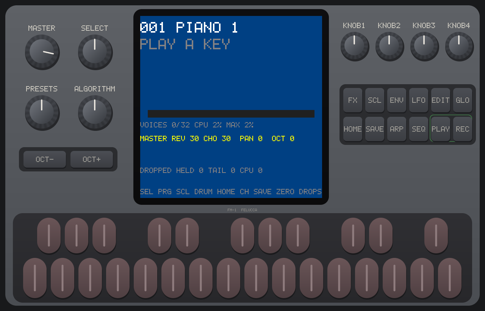

Contents

1. [How it works](#1-how-it-works)
2. [Converting a bank](#2-converting-a-bank)
3. [How small a bank must be](#3-how-small-a-bank-must-be)
4. [Codecs](#4-codecs)
5. [Installing firmware and bank](#5-installing-firmware-and-bank)
6. [The panel](#6-the-panel)
7. [The program page](#7-the-program-page)
8. [The channel page](#8-the-channel-page)
9. [The info page](#9-the-info-page)
10. [Other screens: NO BANK, SAFE MODE, UPLOAD](#10-other-screens)
11. [Playing a MIDI file from the FM-1](#11-playing-a-midi-file-from-the-fm-1)
12. [MIDI reference](#12-midi-reference)

For building the firmware and working on the code, see [DEVELOPING.md](DEVELOPING.md).

---

## 1. How it works

```
 .sf2 file ──► converter (index.html) ──► FM1B bank (.bin / .fm1b) ──┐
                                                                     ├──► install page (install.html) ──USB-MIDI──► FM-1
 firmware package (.fwsc) ───────────────────────────────────────────┘
```

- **The firmware** replaces the FM-1's own synthesizer with a sample player. It lives in the FM-1's program flash and is installed as a
  `.fwsc` package, like M-VAVE's own updates.
- **The bank** is a separate file in the FM-1's sample flash, the 456 KB region the stock firmware uses for its samples. The firmware
  plays it where it lies, without loading it into RAM. Changing the bank does not touch the firmware, and changing the firmware keeps the bank.
- **The bank format (FM1B)** is a SoundFont reduced to what the FM-1 can play: presets with their key and velocity zones, layered zones,
  loop points, volume envelopes, the filter and its envelope, vibrato and tremolo LFOs, pan, reverb and chorus sends, and the samples, mono and
  in one of the codecs below. The full layout is in [FORMAT.md](FORMAT.md).
- **The player** mixes up to 32 voices at 32 kHz, resamples to the FM-1's 44.1 kHz output and adds reverb, chorus and a limiter.
  A CPU guard lowers the number of voices for a moment if the processor runs out of time, so it never stutters.

There are two firmwares. Both have the same screens and controls:

| | SF2 player | SF2 player with live cache |
| --- | --- | --- |
| Bank in flash | a plain bank: SEA5, SEA6, BFP8 or PCM | a BFP8 bank, or a **packed** bank (MP3) that holds about twice as much sound |
| MIDI file player (PLAY) | yes | no (no room left) |
| Status | the tested one | newer, being tested on the device |

The live cache keeps the packed bank's sounds as MP3 in flash and decodes the ones that play into a 72 KB cache in RAM. A sound that is
not cached yet starts a little late the first time it is played.

## 2. Converting a bank

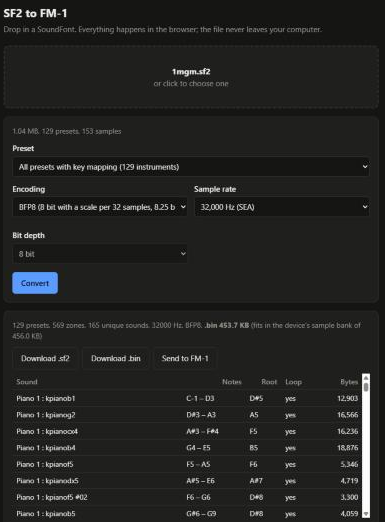

The converter is `index.html` in this repository. Serve the folder (`.\start_web.ps1`, or `python -m http.server 8765`) and open
<http://localhost:8765/index.html> in Chrome or Edge. Everything happens in the browser; the SoundFont never leaves the computer.

1. **Drop an `.sf2` file** on the page. It shows its size, presets and samples.
2. **Preset**: *All presets with key mapping* makes a full General MIDI bank (program numbers, drum kits, every zone). A single preset
   makes a small bank of just that instrument.
3. **Encoding**: the codec of the samples, see [section 4](#4-codecs). BFP8 is the default and the one to use.
4. **Sample rate**: 32,000 Hz is the default and the rate the player works at. Lower rates make the bank smaller and duller
   (22,059 Hz keeps up to about 11 kHz).
5. **Bit depth**: only for raw PCM (8, 12 or 16 bit).
6. **Convert**. The line under it says the bank's size and whether it **fits in the device's sample bank of 456.0 KB**. The table
   lists every sound with its key range, root note, loop and bytes.
7. **Download .bin** saves the bank as `<name>_fm1.bin`. (*Download .sf2* saves the simplified SoundFont, to listen to in any SF2 player.)
   *Send to FM-1* writes the bank straight to an FM-1 that runs the SF2 firmware; the install page does the same.

Below that, *Try it in the FM-1 simulator* plays the converted bank on an on-screen keyboard.

**For the live-cache firmware**, convert to BFP8 at 32,000 Hz first, then pack it (needs Node.js and ffmpeg with libmp3lame):

```bash
node pack_bank.js my_bank_fm1.bin my_bank_packed.fm1b
```

## 3. How small a bank must be

The bank must be at most **466,944 bytes (456.0 KB)**: the size of the FM-1's sample flash. The converter marks a larger bank
*more than the device's sample bank*, and the firmware refuses to take it.

What fits depends on the codec and the sample rate. The repository's General MIDI SoundFont `soundfonts/1mgm.sf2`
(1.04 MB, 129 presets, 153 samples) comes out as:

| Codec | Rate | Bank | Fits |
| --- | --- | --- | --- |
| SEA5 | 32,000 Hz | 345.4 KB | yes |
| SEA6 | 32,000 Hz | 398.0 KB | yes |
| BFP8 | 32,000 Hz | 453.7 KB | yes, just |
| BFP8 | 22,059 Hz | 324.5 KB | yes |
| PCM 8 bit | 32,000 Hz | 438.7 KB | yes |
| PCM 12 bit | 32,000 Hz | 635.0 KB | no |
| PCM 16 bit | 32,000 Hz | 831.1 KB | no |
| Packed (MP3, from the BFP8 bank) | 32,000 Hz | 235.9 KB | yes, half the flash |

A bank that does not fit: pick fewer presets, a lower sample rate, a smaller codec, or (with the live-cache firmware) pack it.
The bank lives in flash, not RAM, so its size does not affect how many voices can play.

## 4. Codecs

Samples are stored mono in one of these formats. The whole bank uses one.

| Codec | Bits per sample | What it is | Use it for |
| --- | --- | --- | --- |
| **BFP8** | 8.25 | Block floating point: 32 samples share one scale, each sample is 8 bits. Clean and cheap to decode. | The default. The only format tested on the device from now on, and the one the live-cache firmware plays. |
| SEA5 | 5.7 | The FM-1's own ADPCM-like codec at 5 bits. | The most sound in the flash, with audible noise on quiet sounds. |
| SEA6 | 6.7 | SEA at 6 bits, about 5 dB less noise than SEA5. | A middle ground (plain firmware only). |
| PCM 8 / 12 / 16 | 8 / 12 / 16 | Plain samples. 12 and 16 bit are too big for a full GM bank. | Small banks of a few presets (plain firmware only). |
| Packed | about 2 | One MP3 stream (64 kbit/s) made from a BFP8 bank by `pack_bank.js`; a few sounds MP3 handles badly stay BFP8. | Twice the sound in the same flash (live-cache firmware only). |

The firmware that does not play a bank's codec shows **NO BANK**.

## 5. Installing firmware and bank

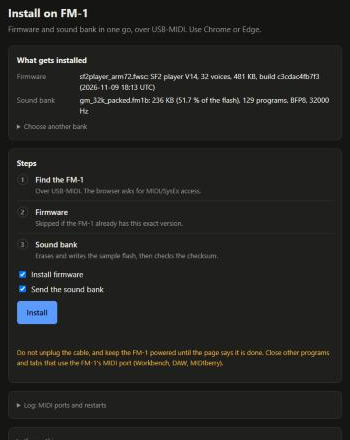

The install page (`install.html`) writes the firmware and the bank over USB-MIDI in one go. It works in Chrome or Edge.

**The first time**, the FM-1 runs M-VAVE's own firmware (or another one). The install page then writes nothing and shows what the
FM-1 runs, for example `FM-1_918`. Tick **Replace … with the SF2 player firmware** and click **Replace and install**: the page takes
the same route as the "Force flash" of M-VAVE's [FM-1 Workbench](https://open.m-vave.com/fm1-workbench), through M-VAVE's own update
loader. The voices and settings of the old firmware are not kept. From M-VAVE's original firmware (`FM-1_015`) this is one step.
From any other firmware it is two: first the original V15 (from fm1_open, published by M-VAVE), then the SF2 player. Some firmware
brings its own update loader that takes only packages of its own layout: Felucca's (`FM-1_9xx`, its loader `ota-FM-1_900`, "Felucca
Update") refuses the SF2 player's package but takes V15. An FM-1 left in such a loader (it comes back there after power-off) is
picked up the same way. If that firmware does not speak the USB-MIDI update protocol, use the
Workbench (Recovery & force update > Force flash) once instead. The original firmware can be put back with the Workbench
("Restore original V15") at any time.

**Every time after that:**

1. Connect the FM-1 with USB and close every other program that uses its MIDI port (a DAW, MIDIberry, the Workbench).
2. Open the install page. **Hosted:** <https://mwedmark.github.io/fm1-sf2/install.html> installs the latest firmware built on GitHub
   (the plain SF2 player) with the default General MIDI bank, nothing to set up. **Local:** `.\start_web.ps1` opens
   <http://localhost:8765/install.html> with the firmware and bank you packed yourself (`build_install.ps1`); from another computer on the
   network, `.\start_web.ps1 -Lan` and the HTTPS address it prints.
3. **What gets installed** shows the firmware package (its name, version, voices, size and build) and the bank (its name, size, share of the
   flash, programs, codec and rate). To install another bank, open *Choose another bank* and pick a `.bin` or `.fm1b` file.
4. Tick what to do: **Install firmware**, **Send the sound bank**, or both.
5. Click **Install** and allow MIDI/SysEx access when the browser asks. The steps:
   1. *Find the FM-1*: the page asks the FM-1 which firmware it runs.
   2. *Firmware*: written by M-VAVE's update loader, after which the FM-1 restarts and the page checks the version it reports.
      Skipped when the FM-1 already has this exact build.
   3. *Sound bank*: erases the sample flash (up to a minute), sends the bank and checks its CRC32. The bank plays as soon as it is checked.
6. Keep the cable in and the FM-1 on until the page says it is done. If it is interrupted, plug in again and click Install again.

The bank on the install page is the one `build_install.ps1` packed with the firmware; the converter's *Send to FM-1* sends a bank on its
own. Check what is on the FM-1 on its [info page](#9-the-info-page): the names and CRC32s there match what the page installed.

**If the FM-1 does not start** after a firmware or bank: switch it off, hold **OCT−** and **OCT+**, switch it on and hold them until the
screen says SAFE MODE ([section 10](#10-other-screens)). The bank is then not used, and the install page can install again.

## 6. The panel


| Control | Program page | Channel page |
| --- | --- | --- |
| **MASTER** | Output volume | Output volume |
| **SELECT** | The panel's program (skips numbers the bank does not have) | The selected channel's program; turning below the first one makes the channel follow the panel's program again (channel 10 always plays the kit) |
| **ALGORITHM** | – | The selected channel's volume (CC 7), 4 steps a click |
| **KNOB1** | – | Moves the cursor (the selected channel) |
| **KNOB2** | Master pan | The selected channel's pan (CC 10) |
| **KNOB3** | Master reverb level | The selected channel's reverb send (CC 91) |
| **KNOB4** | Master chorus level | The selected channel's chorus send (CC 93) |
| **OCT− / OCT+** | The keys' octave, −2 to +2 | Same |
| **SCL** | Keys play the drum kit or the program (only when the bank has a kit) | – |
| **HOME** | Go to the channel page | Go back to the program page |
| **SAVE** | Sets the DROPPED counters to 0 | Same |
| **REC** | Open the info page; REC again goes back | Same |
| **PLAY** | Play or stop the song in RAM (plain firmware) | Same |
| **ARP** | – | Mute or unmute the selected channel |
| **SEQ** | – | Solo the selected channel; again: no solo |
| **EDIT** | – | Arm or disarm the selected row ([layering](#layering-arm)) |
| **GLO** | – | The armed row's MIDI channel, up one (16 wraps to 1) |
| **Keys** | Play F3–G5 (27 keys) on the panel's program, at velocity 100 | Play the armed rows, or the selected channel when none is armed |

PRESETS, FX, ENV and LFO do nothing. The volume, pan and effect knobs move 4 (of 0–127) a click.

**LEDs:** a key lights while it is held. On the channel page **ARP** lights while the selected channel is muted, **SEQ** while it is
soloed, **EDIT** while it is armed and **GLO** while any row is armed. **PLAY** lights while a song plays.

The panel's program plays on every MIDI channel that has not had a program change of its own, so a keyboard on any channel plays
what SELECT shows.

## 7. The program page

The page the FM-1 starts on. HOME switches to the channel page.

**Waiting for a note:**

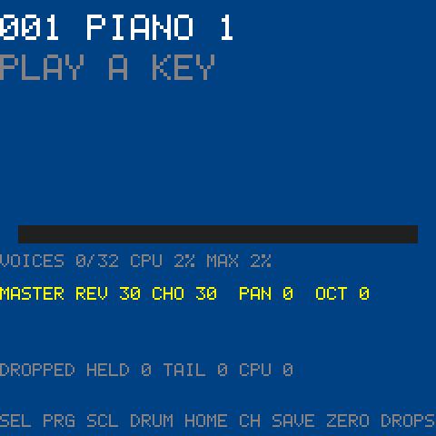

**While notes play** (three notes held, and a program change on channel 2):

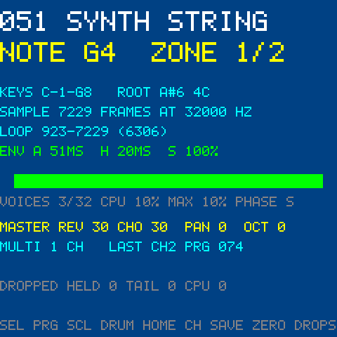

| Line | Example | Meaning |
| --- | --- | --- |
| Title | `051 SYNTH STRING` | The panel's program number (1–128) and preset name. Orange `DRUMS STANDARD` while SCL has the keys on the drum kit. |
| Note | `NOTE G4  ZONE 1/2` | The latest note (from the keys or any MIDI channel) and which of its preset's zones it played: zone 1 of 2. `PLAY A KEY` until the first note. |
| Keys | `KEYS C-1-G8   ROOT A#6 4C` | That zone's key range, its root note (where the sample plays at its own pitch) and fine tuning in cents. |
| Sample | `SAMPLE 7229 FRAMES AT 32000 HZ` | The zone's sample length in samples, and the bank's sample rate. |
| Loop | `LOOP 923-7229 (6306)` | Loop start and end in samples, and the loop's length. `NO LOOP` for a one-shot sound. |
| Envelope | `ENV A 51MS  H 20MS  S 100%` | The zone's attack and hold times and its sustain level. |
| Bar | green bar | The level of the voice playing the latest note. Green while it sounds, orange in its release. |
| Voices | `VOICES 3/32 CPU 10% MAX 10% PHASE S` | Voices sounding / voices allowed; the share of the CPU the audio takes (average, and the highest in the last second); the envelope phase of the latest note: A attack, H hold, D decay, S sustain, R release. |
| Master | `MASTER REV 30 CHO 30  PAN 0  OCT 0` | The master reverb and chorus levels (KNOB3, KNOB4; 0–127), master pan (KNOB2; −64 to +63) and the keys' octave. |
| Multi | `MULTI 1 CH   LAST CH2 PRG 074` | Shown once a MIDI program change has given a channel a program of its own: how many channels have one, and the latest program change (channel and program). |
| Upload | `UPLOAD 14 R0` | After a bank or song was sent ([section 10](#upload)). |
| Dropped | `DROPPED HELD 0 TAIL 0 CPU 0` | Notes the voice limit took since start or the last SAVE. HELD: notes still held, cut off (you hear them stop). TAIL: notes already fading out, cut short (rarely heard). CPU: voices the CPU guard took. Orange while HELD or CPU is not 0. |
| Song | `PLAY SINFONIAS_BWV-78 0:06/1:04` | The song in RAM ([section 11](#11-playing-a-midi-file-from-the-fm-1)). Green with the position while it plays; grey `SONG <name> 1:04  PLAY STARTS` while it waits. |
| Help | `SEL PRG SCL DRUM HOME CH SAVE ZERO DROPS` | SELECT picks the program, SCL the drums, HOME the channel page, SAVE zeroes DROPPED. |

**The voices and CPU line turns orange** when the CPU guard has lowered the voice limit (for example `VOICES 24/28`). Over 80 % CPU it takes
the oldest voices away one or two at a time; under 60 % for a quarter of a second it gives one back. A bank whose sounds are expensive
(filters, many layers) reaches the guard with fewer voices.

**While a song plays:**

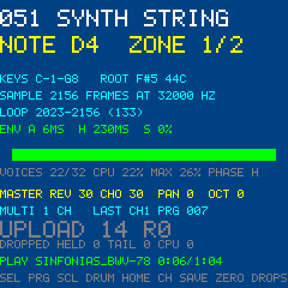

The note lines follow the latest note of any channel, here the song's harpsichord on channel 1, while the title stays the panel's program.

**Drum mode** (SCL; here a snare on channel 10):

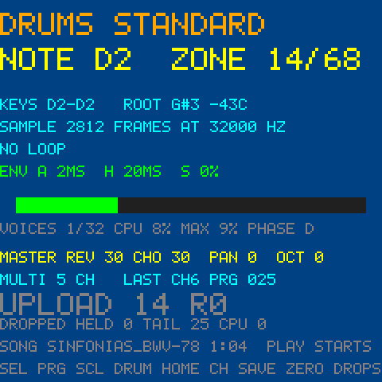

The title is the kit's name in orange; the keys play the kit, one drum per key. The zone counts are the kit's (zone 14 of 68).

## 8. The channel page

HOME on the program page. One row for each of the 16 MIDI channels. KNOB1 moves the cursor (the slate blue row); the other knobs and
ARP, SEQ, EDIT and GLO act on that row.

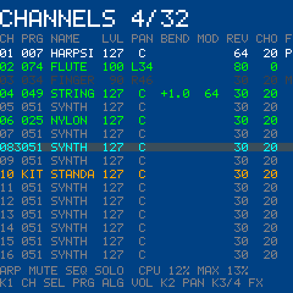

Here channel 1 holds its sustain pedal, channels 2 to 4 have their own programs and controllers, channel 3 is muted, and row 8 is armed
to listen on MIDI channel 3:

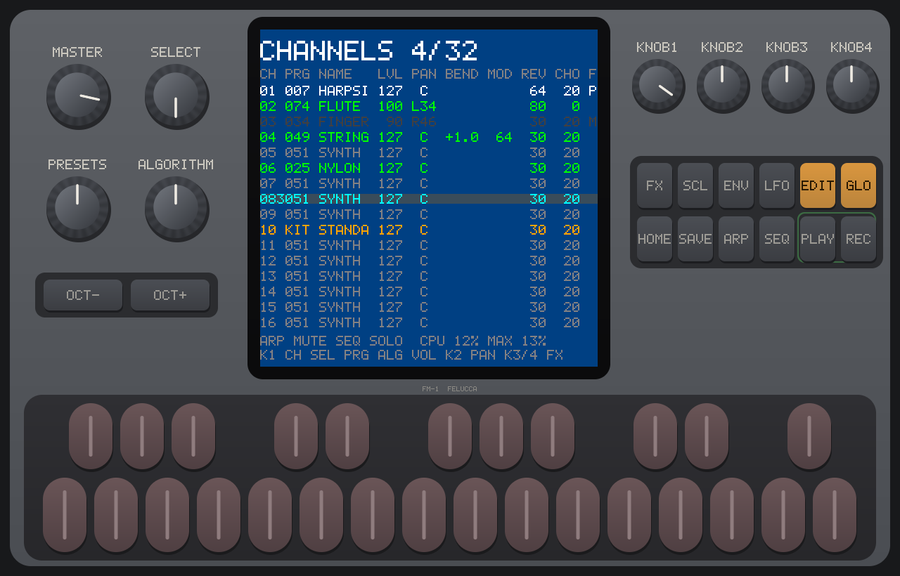

| Part | Example | Meaning |
| --- | --- | --- |
| Title | `CHANNELS 4/32` | Voices sounding / voices allowed (as on the program page). `SOLO` is added in yellow while a channel is soloed. |
| CH | `02` | The MIDI channel. An armed row has a character right after its number: the MIDI channel it listens on, 1–9 then A–G for 10–16 (`083` = row 8, listening on channel 3). |
| PRG | `074` | The program the channel plays (1–128). `KIT` for a drum kit. Channel 10 always plays the kit. |
| NAME | `FLUTE` | The first six letters of the preset's name. |
| LVL | `100` | The channel's level: volume (CC 7) × expression (CC 11) / 127. |
| PAN | `L34`, `C`, `R46` | The channel's pan (CC 10): L64 to L1, C for the centre, R1 to R64. |
| BEND | `+1.0` | Pitch bend in semitones; blank at the centre. |
| MOD | `64` | The modulation wheel (CC 1), which adds vibrato; blank at 0. |
| REV | `80` | The reverb send (CC 91). New channels start at 30. |
| CHO | `0` | The chorus send (CC 93). New channels start at 20. |
| F | `P`, `M`, `S` | M muted, S soloed, else P while the sustain pedal is down. (Only part of this column fits on the screen.) |
| Bottom | `ARP MUTE SEQ SOLO  CPU 12% MAX 13%` | The buttons, and the CPU load as on the program page; orange while the guard holds the limit down. |
| Help | `K1 CH SEL PRG ALG VOL K2 PAN K3/4 FX` | KNOB1 picks the channel, SELECT its program, ALGORITHM its volume, KNOB2 its pan, KNOB3/KNOB4 its sends. |

**Row colours:**

| Colour | Meaning |
| --- | --- |
| Green | The channel is playing (or had a note in the last quarter second). |
| White | It has a program of its own (from a MIDI program change or SELECT). |
| Grey | It follows the panel's program. |
| Orange | Channel 10, the drum kit. |
| Cyan | Armed, and not playing. |
| Dark grey | Silent: muted, or another channel is soloed. Dark green while notes still arrive on it. |

**Mute and solo.** ARP mutes the selected channel: it fades out and its new notes are not played (they still count as arriving). SEQ
solos it: only that channel is heard. SEQ again on the soloed row ends the solo.

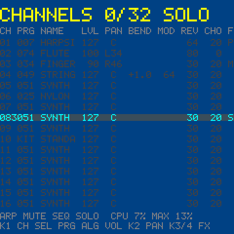

Mute and solo are kept until a new bank is installed or the FM-1 restarts.

### Layering (ARM)

Armed rows play together, so one key plays several instruments:

1. Move the cursor to a row and press **EDIT**. The row is armed, listening on MIDI channel 1, and its number gets a `1`.
2. Press **GLO** to change the MIDI channel it listens on (1 to 16, then 1 again).
3. Arm more rows the same way.

The FM-1's keys then play every armed row. A note that arrives on MIDI channel *m* plays on its own channel's row as always, and also on
every armed row listening on *m*. Each row plays its own program, level, pan and sends. Press EDIT again on a row to disarm it.
Arming is not saved: the FM-1 starts with no row armed.

**While a song plays**, the rows light up as their channels play:

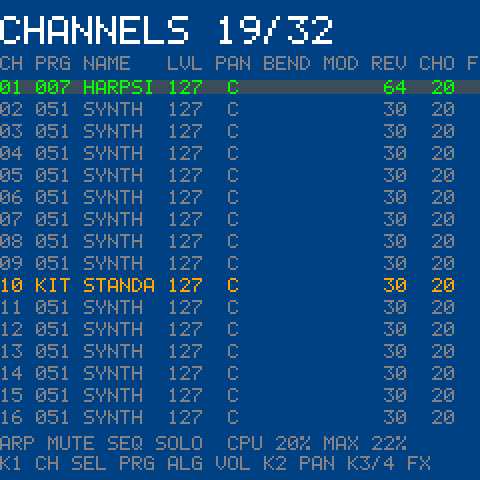

## 9. The info page

REC on any page. REC again goes back. The knobs and keys work as on the page underneath.

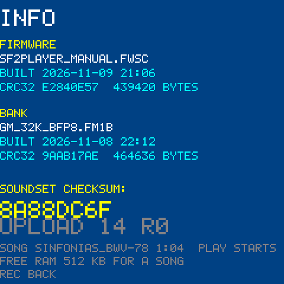

| Line | Example | Meaning |
| --- | --- | --- |
| Firmware name | `SF2PLAYER_MANUAL.FWSC` | The firmware package's name. |
| Built | `BUILT 2026-11-09 21:06` | When the firmware was built. |
| CRC32 | `CRC32 E2840E57  439420 BYTES` | The CRC32 and size of the firmware image, the same as `build_fw.ps1` prints and zip/7-Zip show. |
| Bank name | `GM_32K_BFP8.FM1B` | The bank's name, from when it was converted. `NO NAME (AN OLDER BANK)` for a bank made before names were added; `NO BANK` if none plays. |
| Built | `BUILT 2026-11-08 22:12` | When the bank was converted. |
| CRC32 | `CRC32 9AAB17AE  464636 BYTES` | The CRC32 and size of the whole bank file as it is in flash. |
| Soundset checksum | `8A88DC6F` | One CRC32 over the firmware and the bank together: two FM-1s with the same number sound the same. |
| Upload | `UPLOAD 14 R0` | As on the program page. |
| Song | `SONG ...` | The song in RAM (plain firmware). |
| Free RAM | `FREE RAM 512 KB FOR A SONG` | The largest song that fits in RAM now (at most 128 KB is used). The emulator always shows 512. |

## 10. Other screens

### NO BANK

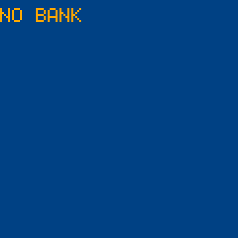

No bank plays: none has been installed, the sample flash was erased, or the bank's codec is one this firmware does not play (a packed
bank on the plain firmware, a SEA or PCM bank on the live-cache firmware). Install a bank ([section 5](#5-installing-firmware-and-bank)).
REC still opens the info page.

### SAFE MODE

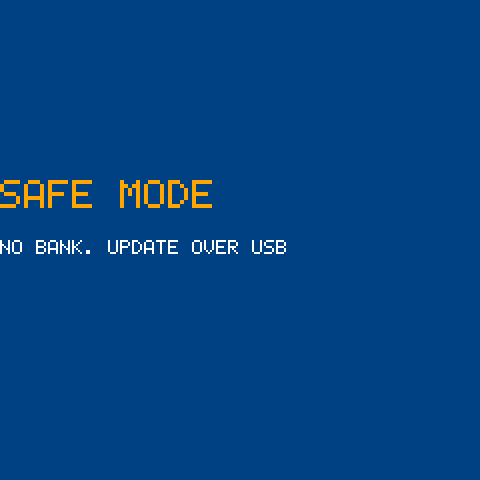

Hold **OCT−** and **OCT+** while switching the FM-1 on. The bank is not used, the keys make no sound, and USB-MIDI, the firmware update and
the bank upload work as usual: use it when a bank or firmware keeps the FM-1 from starting. Switch off and on again without the buttons to
leave it.

### UPLOAD

`UPLOAD 14 R0` appears on the program and info pages once the FM-1 has received a bank or song over MIDI.
The number counts the upload messages it took; `R` is the result of the latest one:

| Code | Meaning |
| --- | --- |
| R0 | Done, no error |
| R1 | A message was malformed |
| R2 | Outside the bank's flash, or the song is too big |
| R3 | The flash could not be written |
| R4 | The CRC32 at the end did not match (the bank is not used), or the data is not a song |
| R5 | Data without a begin message first, or PLAY without a song |
| R6 | No RAM for the song |

## 11. Playing a MIDI file from the FM-1

The plain firmware can hold one song in RAM and play it from the panel:

1. Open <http://localhost:8765/song.html> (served by `.\start_web.ps1`) in Chrome or Edge.
2. Drop a `.mid` file and click **Send to FM-1**. The page turns it into the FM-1's song format (the channel messages with their times;
   aftertouch, meta events and SysEx are left out) and sends it.
3. **PLAY** on the FM-1 plays it from the start, PLAY again stops it (pedals up and all notes off). The program page shows its name and
   position.

A song can be up to 128 KB (about the size of the MIDI file). It is gone when the FM-1 is switched off.

## 12. MIDI reference

The FM-1 takes MIDI from USB, the DIN input and Bluetooth MIDI, on all 16 channels.

| Message | What it does |
| --- | --- |
| Note on / off | Plays the channel's program. Channel 10 plays the drum kit. Also plays on armed rows listening on the channel. |
| Program change | Gives the channel its own program from the bank (a program the bank does not have is ignored). Not on channel 10. |
| CC 0 / 32 bank select | Bank 120, or MSB 1 with LSB 0, makes the next program change pick a drum kit; any other bank is the melodic one. |
| CC 1 modulation | Vibrato, 5.5 Hz, up to ±50 cents |
| CC 7 volume, CC 11 expression | The channel's level, on the General MIDI curve |
| CC 10 pan | The channel's pan |
| CC 64 sustain | Sustain pedal |
| CC 91 / CC 93 | Reverb and chorus send (the panel's KNOB3/KNOB4 set the master levels) |
| CC 101/100 + 6/38 (RPN 0) | Pitch bend range, 2 semitones until set, at most 24 |
| CC 120 / 121 / 123 | All sound off / reset controllers / all notes off, on that channel |
| Pitch bend | Per channel |
| SysEx `F0 7D 'S' 'F' 02 ...` | The bank and song upload the install page and song page use ([FIRMWARE.md](FIRMWARE.md), `fm1_open/app/sf2_upload.c`) |

Notes from the FM-1's own keys play at velocity 100.

---

The firmware is built on [m-vave/fm1_open](https://github.com/m-vave/fm1_open) (GPLv3 with the FM1 SDK linking exception, see
`fm1_open/LICENSE.md`). The screenshots are from fm1-emu (MIT) running the plain firmware with `dist/gm_32k_bfp8.fm1b`.

If you like it: [🍺 Buy me a beer](https://ko-fi.com/overclocked73).
